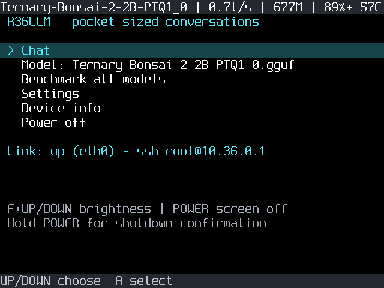
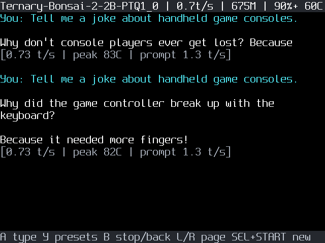
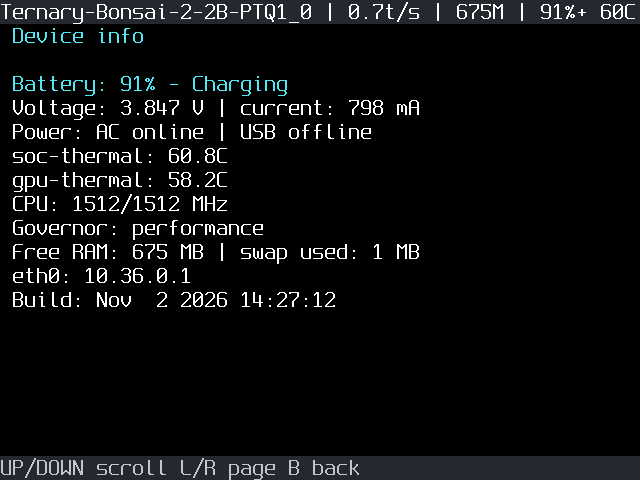
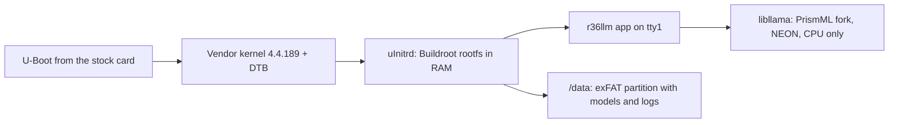

# R36LLM: a tiny AI in your pocket

A minimal Linux OS for the **R36S** retro handheld (RK3326, 4× Cortex-A35, 1 GB RAM) that boots straight into an offline LLM chat app. You type with the gamepad, and the console answers using [PrismML Bonsai](https://huggingface.co/prism-ml) 1-bit and ternary models running on the CPU through PrismML's [llama.cpp fork](https://github.com/PrismML-Eng/llama.cpp).

It is a fun proof of concept, not a fast assistant. The default model writes about 0.7 tokens per second (31 words per minute, so a short paragraph takes about 2.5 minutes). The fastest Bonsai, Ternary-Bonsai-1.7B, reaches 1.0 t/s, and every model heats the passively cooled chip to 82–85 °C. Full numbers: [benchmarks](docs/benchmarks.md).

|Home|Chat|Device info|
|---|---|---|
||||

## Features

- Boots in seconds into the chat app; no desktop, no emulators.
- On-screen keyboard driven by the D-pad, preset prompts, multi-turn chat, B to stop a reply.
- Model picker, an on-device benchmark of every model, and chat logs saved to the SD card.
- Status bar with tokens/s, free RAM, battery and SoC temperature.
- Settings: threads, context size, reply length, temperature, brightness, screen timeout and CPU mode.
- Power key turns the screen off; holding it opens the shutdown prompt. The device shuts down safely when the battery is critical.
- SSH over a USB Ethernet adapter on the OTG port, for a PC command line and fast app updates.

## Hardware

Tested on an R36S clone with board `G80CA-MB V1.3-20251212 Panel 8`, 1 GB RAM. Other R36S variants share the SoC and likely work, but each board needs its own kernel and device tree from its stock card (see [Harvest the vendor files](#2-harvest-the-vendor-files)).

The PC link uses a USB Ethernet adapter on the R36S OTG port (tested: ASIX AX88179). Drivers for Realtek RTL8152/8153, ASIX AX88772, CDC Ethernet/NCM and SMSC95xx adapters are included too. USB device mode over a plain cable does not work on this board's vendor kernel (see the [session notes](docs/sessions/2026-11-02-01.md)).

## How it works



- **Root filesystem**: Buildroot 2025.02 (glibc, BusyBox init, dropbear), packed as a 9 MB initramfs (`uInitrd`). The OS runs from RAM, so the SD card is only written for logs, chats and settings.
- **Engine**: PrismML llama.cpp fork pinned in `br2-external/package/prism-llama-cpp`, built for plain ARMv8.0 (the A35 has no dotprod or i8mm).
- **App**: `app/` is C++17 with no UI toolkit. It draws directly to the framebuffer with the [Spleen](https://github.com/fcambus/spleen) 12×24 font and reads the gamepad through evdev.
- **SD card layout**: partition 1 holds the boot files, partition 2 (the stock OS root filesystem) becomes swap, and partition 3 (exFAT) is `/data` with models, settings and logs.

## Build and install

Requirements: Windows with PowerShell, [Docker Desktop](https://www.docker.com/products/docker-desktop/), Python 3, and the R36S stock SD card (ArkOS/dArkOS family).

> **Warning:** step 5 erases the stock OS and all ROMs on the card. Back up anything you want to keep.

### 1. Clone

```powershell
git clone https://github.com/0bAndyWirus/r36llm.git
cd r36llm
```

### 2. Harvest the vendor files

The kernel, device tree and a few kernel modules come from **your own** stock card; they are not redistributed here. With the stock card in the PC:

```powershell
scripts/stage-probe.ps1      # copies the probe to the card's ports folder
```

Boot the R36S with the stock card and run **Ports → R36LLM-Probe**. It collects hardware facts and the kernel modules (a USB cable test runs at the end and can be ignored). Then put the card back in the PC:

```powershell
scripts/backup-card.ps1      # saves the boot partition and the harvest to vendor/ (gitignored)
```

### 3. Build

```powershell
scripts/build.ps1            # first build ≈ 1 h; output in out/
```

This also creates an SSH key (`~/.ssh/r36llm`) and bakes its public key into the image.

### 4. Download models

```powershell
scripts/fetch-models.ps1     # ≈ 1.7 GB into models/; use -Small for 512 MB units
```

### 5. Install to the card

```powershell
scripts/deploy.ps1 -Wipe     # erases the stock OS/ROMs, installs the OS, models and config
```

Insert the card into the R36S and power on. The home screen appears after a few seconds, and the first model load takes about 15 s.

## Connect from the PC

Plug a USB Ethernet adapter into the R36S OTG port and cable it to a free Ethernet port on the PC. The device serves DHCP (`10.36.0.2`–`10.36.0.10`) and listens on `10.36.0.1`. Add this to `~/.ssh/config`:

```
Host r36
  HostName 10.36.0.1
  User root
  IdentityFile ~/.ssh/r36llm
  UserKnownHostsFile ~/.ssh/r36llm_known_hosts
  LogLevel ERROR
```

The first `ssh r36` asks you to confirm the device's host key, which is then stored in `~/.ssh/r36llm_known_hosts`. The key lives on the data partition (`/data/r36llm/ssh`), so it survives reboots. After you reflash or reinitialize the card, remove the old entry with `ssh-keygen -f ~/.ssh/r36llm_known_hosts -R 10.36.0.1`.

```powershell
ssh r36 "llama-cli -m /data/r36llm/models/Bonsai-1.7B-Q1_0.gguf -p 'Hello' -n 32 -st"
scripts/bench.ps1            # benchmark all models -> docs/benchmarks.md
scripts/screenshot.ps1 home  # screen capture -> docs/images/home.png
scripts/push-app.ps1         # install a rebuilt app without reflashing
```

Without an adapter: put a shell script at `r36llm/autorun.sh` on the card. It runs once at the next boot and writes its output to `r36llm/logs/autorun.log` (see `card/r36llm/autorun.sh.example`).

## Controls

|Screen|Buttons|
|---|---|
|Anywhere|F + Up/Down: brightness · Power: screen off/on · hold Power: shutdown prompt|
|Home, menus|Up/Down: choose · A: select · B: back|
|Chat|A: keyboard · Y: preset prompts · B: stop reply / back · Up/Down, L1/R1: scroll · SELECT+START: new chat|
|Keyboard|D-pad: move · A: press key · B: delete · X: space · Y: shift · START: send · SELECT: cancel|

## Configuration

`r36llm/config.ini` on the card (exFAT, editable from any PC):

|Key|Default|Meaning|
|---|---|---|
|`model`|`Ternary-Bonsai-2-2B-PTQ1_0.gguf`|Model file in `r36llm/models/` loaded at start|
|`threads`|`4`|CPU threads (1-4)|
|`ctx`|`2048`|Context length in tokens|
|`max_tokens`|`256`|Maximum reply length|
|`temp`, `top_p`, `top_k`|`0.5`, `0.9`, `20`|Sampling|
|`system`|short persona|System prompt|
|`brightness`|`80`|Screen brightness in percent|
|`screen_timeout`|`2`|Minutes until the screen turns off (0 = never)|
|`cpu_mode`|`performance`|`performance`, `balanced` or `saver`|
|`swap_p2`|`1`|Use partition 2 as swap (formats it on first boot)|
|`link`|`ethernet`|PC link: `ethernet`, `gadget` (experimental) or `off`|

Preset prompts are in `r36llm/prompts.txt`, one per line.

## Repository layout

|Path|Contents|
|---|---|
|`app/`|The `r36llm` chat app (C++17)|
|`br2-external/`|Buildroot external tree: defconfig, packages, init scripts, post-build/post-image hooks|
|`card/r36llm/`|Default config, prompts and autorun example copied to the SD card|
|`docker/`, `scripts/br.sh`|Reproducible build environment|
|`scripts/`|PC-side tooling: build, deploy, models, benchmark, screenshots, app push|
|`tools/`|Device probe, font converter, boot image generator, image converters|
|`docs/`|Benchmarks, screenshots and development session notes|

## Licenses and credits

- This project: [MIT](LICENSE).
- [PrismML llama.cpp fork](https://github.com/PrismML-Eng/llama.cpp) (MIT), downloaded at build time.
- [Buildroot](https://buildroot.org) (GPL-2.0), downloaded at build time. `overlay/etc/inittab` is derived from Buildroot's and stays GPL-2.0.
- [Spleen](https://github.com/fcambus/spleen) font by Frederic Cambus (BSD-2-Clause), embedded in `app/src/font.h` with its notice.
- Models: [PrismML Bonsai](https://huggingface.co/prism-ml) and [SmolLM2](https://huggingface.co/HuggingFaceTB/SmolLM2-135M-Instruct) (Apache-2.0), downloaded separately.
- The vendor kernel, device tree, kernel modules and U-Boot come from your device's stock card and are **not** part of this repository. A fully source-built release image is planned.

R36S is a product of its respective manufacturers; this project is not affiliated with them.
