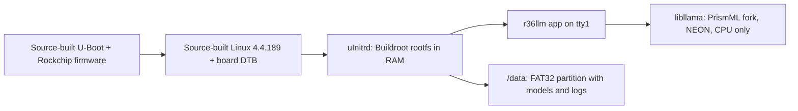

# R36LLM: a tiny AI in your pocket

A minimal Linux OS for the **R36S** retro handheld (RK3326, 4× Cortex-A35, 1 GB RAM) that boots straight into an offline LLM chat app. You type with the gamepad, and the console answers using [PrismML Bonsai](https://huggingface.co/prism-ml) 1-bit and ternary models running on the CPU through PrismML's [llama.cpp fork](https://github.com/PrismML-Eng/llama.cpp).

It is a fun proof of concept, not a fast assistant. The default model is [Ternary-Bonsai-2-2B](https://huggingface.co/prism-ml/Ternary-Bonsai-2-2B-gguf) (file `Ternary-Bonsai-2-2B-PTQ1_0.gguf`, 409 MB). It writes about 0.9 tokens per second (about 41 words per minute, so a 100-token answer takes just under 2 minutes). The fastest Bonsai, Bonsai-1.7B (Q1_0), reaches 1.5 t/s. See [Performance](#performance).

|Home|Chat|Device info|
|---|---|---|
||||

## Features

- Boots in seconds into the chat app; no desktop, no emulators.
- On-screen keyboard driven by the D-pad, preset prompts, multi-turn chat, B to stop a reply.
- Model picker, an on-device benchmark of every model, and chat logs saved to the SD card.
- Status bar with tokens/s, free RAM, battery and SoC temperature.
- Settings: threads, context size, reply length, temperature, brightness, screen timeout and CPU mode.
- Power key turns the screen off; holding it opens the shutdown prompt. The device shuts down safely when the battery is critical.
- SSH over a USB Ethernet adapter on the OTG port, for a PC command line and fast app updates.

## Performance

Measured on the device on 2026-11-02 with 4 threads, `cpu_mode=performance` and the image's NEON patch (`llama-bench -p 64 -n 32`, mean of two rounds, each run started at ≤ 50 °C):

|Model|File|Prompt t/s|Generation t/s|100-token answer|
|---|---:|---:|---:|---:|
|Bonsai-1.7B-Q1_0|237 MB|2.04|1.46|68 s|
|Ternary-Bonsai-1.7B-PQ2_0|442 MB|1.97|1.40|72 s|
|**Ternary-Bonsai-2-2B-PTQ1_0** (default)|409 MB|1.45|0.92|109 s|

- The NEON patch makes generation 11 % faster for the ternary models and 40 % faster for Q1_0, with bit-identical results.
- Long answers heat the passively cooled chip to about 83 °C, and the CPU then throttles by about 5 %. `cpu_mode=saver` stays below 73 °C but is about 27 % slower.
- Bonsai-4B (0.38 t/s) and SmolLM2-135M (10 t/s) were measured only before the patch.

Full methodology and raw data: [benchmarks](docs/benchmarks.md).

## Hardware

Target board: R36S clone `G80CA-MB V1.3-20251212 Panel 8`, 1 GB RAM. The original vendor-kernel installation was tested on this board. The source-built image requires a separate hardware boot test; do not assume compatibility with other R36S variants.

A route to mainline Linux 6.12 is prepared but not yet built or tested on hardware; see [docs/mainline.md](docs/mainline.md). Keep a Linux 4.4 card as fallback.

The PC link uses a USB Ethernet adapter on the R36S OTG port (tested: ASIX AX88179). Drivers for Realtek RTL8152/8153, ASIX AX88772, CDC Ethernet/NCM and SMSC95xx adapters are included too. USB device mode over a plain cable does not work on this board's vendor kernel (see the [session notes](docs/sessions/2026-11-02-01.md)). The PC needs an Ethernet port too. Many laptops and small PCs don't have one; then use a second USB Ethernet adapter on the PC, or a USB-C dock with Ethernet.

## How it works



- **Root filesystem**: Buildroot 2025.02 (glibc, BusyBox init, dropbear), packed as an approximately 11 MiB initramfs (`uInitrd`). The OS runs from RAM, so the SD card is only written for logs, chats and settings.
- **Engine**: PrismML llama.cpp fork pinned in `br2-external/package/prism-llama-cpp`, built for plain ARMv8.0 (the A35 has no dotprod or i8mm).
- **App**: `app/` is C++17 with no UI toolkit. It draws directly to the framebuffer with the [Spleen](https://github.com/fcambus/spleen) 12×24 font and reads the gamepad through evdev.
- **Fresh image layout**: raw Rockchip bootloader area, 128 MiB FAT32 boot partition, 512 MiB swap partition, and a FAT32 data partition. On first boot the empty data partition grows to fill the card, leaving 1 MiB at the end. No model is included.

## Build and install

Requirements: Windows with PowerShell and Docker Desktop (Linux containers), an SD card of at least 1 GB, and a card writer. Builds also work from a Linux Docker host through the shell entry points. No harvested vendor kernel or modules are needed.

> **Warning:** flashing an image replaces the card's partition table and erases its contents. Back up the entire stock card first. Do not flash an internal PC disk.

### 1. Build the image

```powershell
git clone https://github.com/0bAndyWirus/r36llm.git
cd r36llm
scripts/build.ps1
```

The build pins the BSP and U-Boot revisions in `scripts/bsp/`, cross-compiles them with GCC 8 in Docker, builds the Buildroot initramfs, and runs genimage. Linux-volume checkouts avoid Windows reserved filenames in the kernel tree.

On Windows, the build enables NTFS case sensitivity for `out/bsp/artifacts/modules/`. This preserves module pairs such as `xt_DSCP.ko` and `xt_dscp.ko`; copying that tree to a case-insensitive directory can silently lose drivers. The raw image itself has no such host-filesystem requirement.

Outputs:

- `out/bsp/artifacts/r36llm.img`: 800 MiB raw disk image, without models.
- `out/bsp/artifacts/{Image,rk3326-r36s-linux.dtb,idbloader.img,uboot.img,trust.img}`: boot components.
- `out/bsp/artifacts/modules/`: all source-built kernel modules; the initramfs includes only needed loadable drivers.
- `out/uInitrd`, `out/r36llm`: initramfs and application for updates.

The image uses 512-byte sectors. Raw loader offsets follow upstream `Clone-u-boot/sd_fuse/sd_fusing.sh`; the SD U-Boot environment at 1 MiB remains reserved.

|Region|Start sector|Size|
|---|---:|---|
|MBR|0|512 bytes|
|idbloader|64|DDR initialization + miniloader|
|U-Boot environment|2048|32 KiB reserved|
|U-Boot|16384|`uboot.img`|
|Trust firmware|24576|`trust.img`|
|p1: R36BOOT (FAT32)|32768|128 MiB|
|p2: R36SWAP|294912|512 MiB|
|p3: R36DATA (FAT32)|1343488|128 MiB before first-boot growth|

The kernel and U-Boot are built from source. DDR initialization, the miniloader, BL31 and BL32 are Rockchip firmware binaries redistributed under the rkbin license; see [firmware notices](THIRD-PARTY/firmware/NOTICE). This is not a blob-free boot chain.

The default build creates a personal SSH key when `keys/authorized_keys` is missing and embeds its public key. Use `scripts/build.ps1 -Release` for a distributable image: it neither generates nor embeds a personal authorization key, even if one already exists. The default login is `root` with password `r36llm`; change it before connecting the device to an untrusted network. Do not publish images containing private credentials or data.

### 2. Flash and initialize

On Windows, run `scripts/flash.ps1 -WhatIf` to list the removable disks it would accept. Then, in PowerShell **as Administrator**, run `scripts/flash.ps1`, pick the SD card, and type its disk number again to confirm the erase. The script writes `out/bsp/artifacts/r36llm.img`, then reads the card back and checks its SHA256. For a release download, keep `SHA256SUMS` next to the image and run `scripts/flash.ps1 -ImagePath .\r36llm.img.xz`. This needs `xz.exe` or `7z.exe` on `PATH` and enough free space in TEMP to unpack the image. Any image writer with verification works too, such as balenaEtcher. Eject the card safely, insert it in the handheld, and power on.

**Boot once before copying models.** The first boot verifies the release disk signature and labels, expands partition 3, and formats its initially empty FAT32 filesystem. It refuses to erase a data partition containing files other than the release marker. The boot-partition marker records interrupted initialization so it can resume. Never copy files onto the card while initialization is pending.

The fresh image has a preformatted 512 MiB swap partition; no old OS partition needs to be repurposed. The `swap_p2` setting enables it. FAT32 limits individual files to 4 GiB, which exceeds all currently supported models.

Boot-test checklist for a spare card:

1. Verify `r36llm.img` against `r36llm.img.sha256`, then select the **whole removable card** in the image writer and enable write verification.
2. Boot on the specified Panel 8 board. Check that the display, controls, battery reading, audio, and shutdown work.
3. Over USB Ethernet, check `uname -r`, `mount`, `cat /proc/swaps`, and `/data/r36llm/logs/boot.log`. Partition 3 should fill the card except for the reserved final MiB; partition 1's `r36-grow.txt` should be gone.
4. Reboot before adding a model. Confirm data persists and initialization does not run again. Then add a GGUF and test inference and chat logging.

Offline image checks cannot establish that the board boots or that its Panel 8 display and USB hardware work. Those checks remain required on the device.

### 3. Add a model

Download a GGUF model separately from the model publisher, or use:

```powershell
scripts/fetch-models.ps1
```

After the first boot, shut down and put the card in the PC. Copy the desired `.gguf` file to `R36DATA:\r36llm\models\` (use the actual drive letter), or copy it over SSH to `/data/r36llm/models/`. The default model name is `Ternary-Bonsai-2-2B-PTQ1_0.gguf`; edit `r36llm/config.ini` to select another. `scripts/deploy.ps1` updates an initialized card's boot files and copies locally downloaded models; it does not flash U-Boot.

### Source and license bundle

Before distributing an image, run:

```powershell
scripts/build.ps1 legal-info
```

Ship the Buildroot `legal-info` directory (in the `r36llm-br` Docker volume under `/home/br/work/output/legal-info`), the kernel and U-Boot source archives and configurations from `out/bsp/artifacts`, this repository's build scripts and patches at the matching revision, and `THIRD-PARTY/firmware/{NOTICE,LICENSE}`. Keep the corresponding source available alongside the image; a link to an upstream branch alone is not a complete source bundle.

For diagnosing a different board, `scripts/stage-probe.ps1` and `scripts/backup-card.ps1` still collect stock-card hardware facts into the gitignored `vendor/` directory. Do not redistribute harvested vendor binaries as though they were source-built.

## Connect from the PC

You need two Ethernet ports, one on each end:

- **R36S side:** a USB Ethernet adapter in the R36S OTG port (tested: ASIX AX88179). An OTG adapter or cable may be needed, depending on the adapter's plug.
- **PC side:** the PC's own Ethernet port. If it doesn't have one (common on laptops), use any USB Ethernet adapter or a USB-C dock with Ethernet.

Connect the two directly with a regular Ethernet cable; a crossover cable isn't needed. The R36S hands the PC an address (`10.36.0.2`–`10.36.0.10`) and listens on `10.36.0.1`, so the PC side needs no network setup.

**Do not plug the R36S into your router or a switch on your home network:** it runs its own DHCP server and would hand out addresses to other devices on your network.

Then add this to `~/.ssh/config`:

```
Host r36
  HostName 10.36.0.1
  User root
  IdentityFile ~/.ssh/r36llm
  UserKnownHostsFile ~/.ssh/r36llm_known_hosts
  LogLevel ERROR
```

The first `ssh r36` asks you to confirm the device's host key, which is then stored in `~/.ssh/r36llm_known_hosts`. The key lives on the data partition (`/data/r36llm/ssh`), so it survives reboots. After you reflash or reinitialize the card, remove the old entry with `ssh-keygen -f ~/.ssh/r36llm_known_hosts -R 10.36.0.1`.

```powershell
ssh r36 "llama-cli -m /data/r36llm/models/Bonsai-1.7B-Q1_0.gguf -p 'Hello' -n 32 -st"
scripts/bench.ps1            # benchmark all models -> docs/benchmarks.md
scripts/screenshot.ps1 home  # screen capture -> docs/images/home.png
scripts/push-app.ps1         # install a rebuilt app without reflashing
```

Without an adapter: put a shell script at `r36llm/autorun.sh` on the card. It runs once at the next boot and writes its output to `r36llm/logs/autorun.log` (see `card/r36llm/autorun.sh.example`).

## Controls

|Screen|Buttons|
|---|---|
|Anywhere|F + Up/Down: brightness · Power: screen off/on · hold Power: shutdown prompt|
|Home, menus|Up/Down: choose · A: select · B: back|
|Chat|A: keyboard · Y: preset prompts · B: stop reply / back · Up/Down, L1/R1: scroll · SELECT+START: new chat|
|Keyboard|D-pad: move · A: press key · B: delete · X: space · Y: shift · START: send · SELECT: cancel|

## Configuration

`r36llm/config.ini` on the data partition (FAT32 on fresh images, exFAT on legacy cards):

|Key|Default|Meaning|
|---|---|---|
|`model`|`Ternary-Bonsai-2-2B-PTQ1_0.gguf`|Model file in `r36llm/models/` loaded at start|
|`threads`|`4`|CPU threads (1-4)|
|`ctx`|`2048`|Context length in tokens|
|`max_tokens`|`256`|Maximum reply length|
|`temp`, `top_p`, `top_k`|`0.5`, `0.9`, `20`|Sampling|
|`system`|short persona|System prompt|
|`brightness`|`80`|Screen brightness in percent|
|`screen_timeout`|`2`|Minutes until the screen turns off (0 = never)|
|`cpu_mode`|`performance`|`performance`, `balanced` or `saver`|
|`swap_p2`|`1`|Enable the fresh image's preformatted swap partition; on legacy cards, explicitly opting in can format the old p2 rootfs|
|`link`|`ethernet`|PC link: `ethernet`, `gadget` (experimental) or `off`|
|`keymap`|`auto`|Gamepad mapping: `auto` picks one from the gamepad's device name, then from the kernel version (6 or newer = mainline). Set `vendor44` or `mainline` to force one|

Preset prompts are in `r36llm/prompts.txt`, one per line.

## Repository layout

|Path|Contents|
|---|---|
|`app/`|The `r36llm` chat app (C++17)|
|`br2-external/`|Buildroot external tree: defconfig, packages, init scripts, post-build/post-image hooks|
|`card/r36llm/`|Default config, prompts and autorun example copied to the SD card|
|`docker/`, `scripts/br.sh`|Reproducible build environment|
|`scripts/`|PC-side tooling: build, deploy, models, benchmark, screenshots, app push|
|`tools/`|Device probe, font converter, boot image generator, image converters|
|`docs/`|Benchmarks, screenshots and development session notes|

## Contributing

See [CONTRIBUTING.md](CONTRIBUTING.md) for how to contribute and [CHANGELOG.md](CHANGELOG.md) for changes. Report vulnerabilities privately as described in [SECURITY.md](SECURITY.md).

## Licenses and credits

- This project: [MIT](LICENSE).
- [PrismML llama.cpp fork](https://github.com/PrismML-Eng/llama.cpp) (MIT), downloaded at build time.
- [Buildroot](https://buildroot.org) (GPL-2.0), downloaded at build time. `overlay/etc/inittab` is derived from Buildroot's and stays GPL-2.0.
- [Spleen](https://github.com/fcambus/spleen) font by Frederic Cambus (BSD-2-Clause), embedded in `app/src/font.h` with its notice.
- Models: [PrismML Bonsai](https://huggingface.co/prism-ml) and [SmolLM2](https://huggingface.co/HuggingFaceTB/SmolLM2-135M-Instruct) (Apache-2.0), downloaded separately.
- Linux BSP and U-Boot: GPL-2.0-family licenses and component-specific notices in their source trees. The release uses source-built binaries, not harvested vendor kernel/modules.
- Rockchip boot firmware: binary redistribution under the rkbin license; exact filenames, provenance and license text are in [THIRD-PARTY/firmware](THIRD-PARTY/firmware/NOTICE).

R36S is a product of its respective manufacturers; this project is not affiliated with them.
